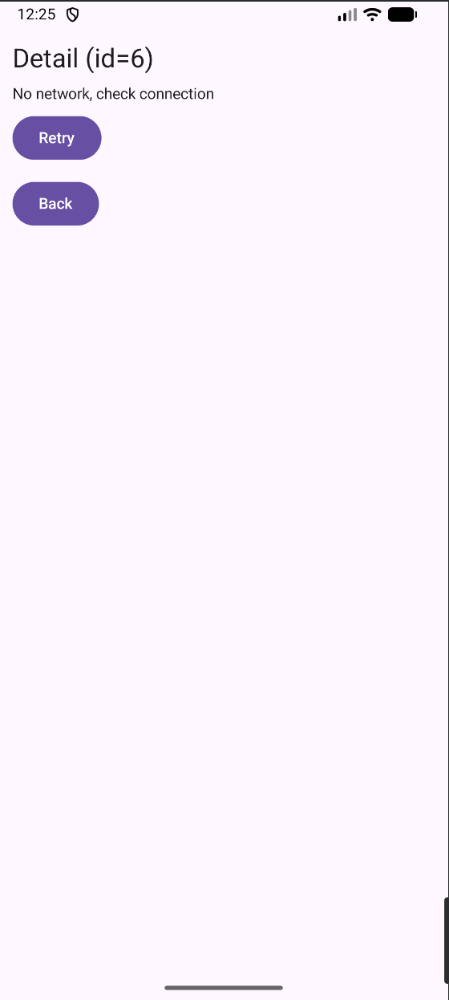
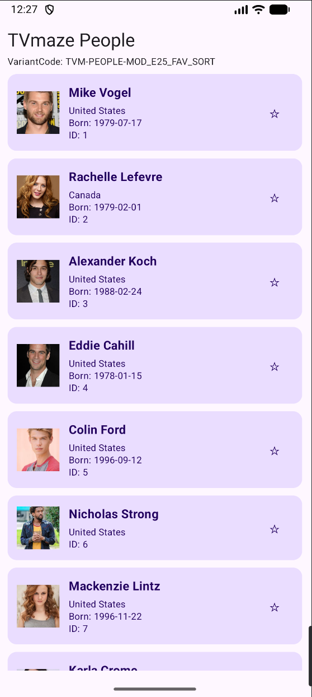
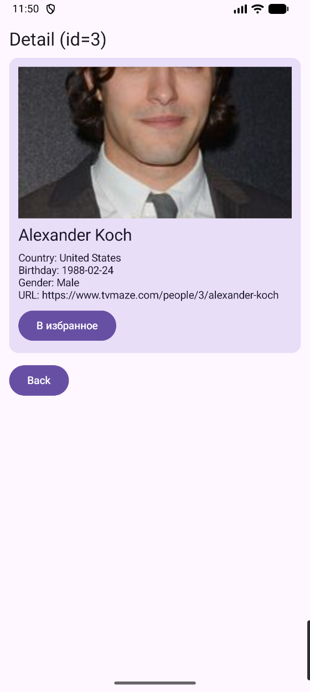
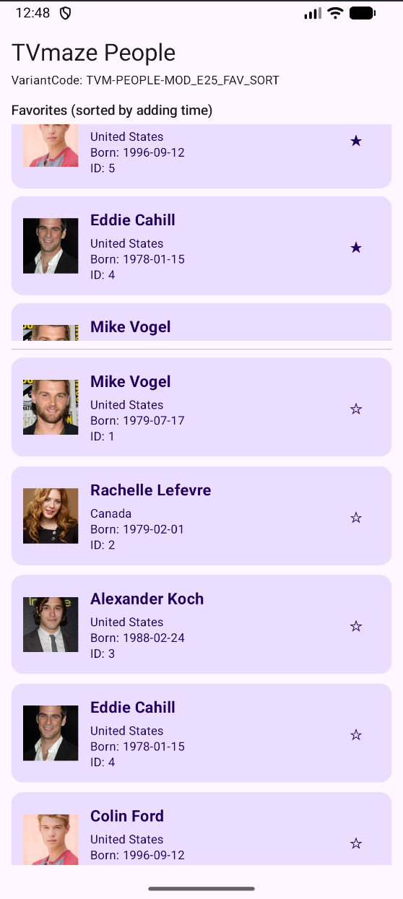

# FavPeople — ДЗ №4: Hilt + Room

**ФИО:** Алалин Алексей Юрьевич  
**Группа:** ПИКД Б9123-09.03.03, 5 подгруппа  
**VariantCode:** TVM-PEOPLE-MOD_E25_FAV_SORT

## Какой API
TVmaze API — `https://api.tvmaze.com`

| Экран | Endpoint | Зачем |
|---|---|---|
| Список (List) | `GET /people?page=0` | первые 20 людей на главном экране |
| Детали (Detail) | `GET /people/{id}` | детали человека по id |

## Что сделано в ДЗ 4

### Hilt (внедрение зависимостей)
- `ComWApp` помечен `@HiltAndroidApp`, `MainActivity` — `@AndroidEntryPoint`, ViewModel — `@HiltViewModel`.
- Модули: `NetworkModule` (OkHttp, Retrofit, `TvmApi`), `DatabaseModule` (Room, DAO, `TimeProvider`),
  `RepositoryModule` (`@Binds` интерфейс → реализация).
- В UI и ViewModel ничего не создаётся вручную: ни Retrofit, ни база, ни репозитории.

### Room — 2 таблицы, 2 сценария
| Таблица | Сценарий | Что хранится |
|---|---|---|
| `favorites` | **Favourites** — избранное переживает перезапуск | id, имя, страна, дата рождения, пол, фото, url, `addedAt` |
| `view_history` | **History** — история просмотров деталей | те же поля + `viewedAt` |

- Избранное сортируется по времени добавления (`ORDER BY addedAt DESC`) — модификатор варианта **MOD_E25_FAV_SORT**.
- Повторное добавление в избранное не создаёт дубль (`personId` — первичный ключ, `OnConflictStrategy.IGNORE`).
- Повторный просмотр того же человека обновляет время в истории, а не добавляет вторую строку (`REPLACE`).
- DAO отдают `Flow`, поэтому звёздочки, блок «Избранное» и экран истории обновляются сами.

### Приложение из ДЗ 3 осталось рабочим
- Экраны: список `people_list`, детали `people_detail/{id}`, новый экран истории `history` (Navigation Compose).
- Retrofit + coroutines + `viewModelScope`.
- Состояния UI: `Loading` / `Error` + Retry / `Empty` / `Content` (Success).

## Как проверить («сделал → перезапустил → осталось»)
1. Запустить приложение, нажать ☆ у 2–3 человек → они появляются сверху в блоке «Избранное» (последний добавленный — первым).
2. Открыть детали 2–3 человек, вернуться и нажать «История» → там открытые люди со временем просмотра.
3. Полностью закрыть приложение (смахнуть из недавних) и запустить снова.
4. Избранное и история на месте — данные читаются из Room.
5. Проверить таблицы можно в Android Studio: **App Inspection → Database Inspector → favpeople.db**.

## Скриншоты
| Loading | Error + Retry | List | Detail |
|---|---|---|---|
|  |  |  |  |

| Избранное | Состояние Room (Database Inspector) |
|---|---|
|  |  |
